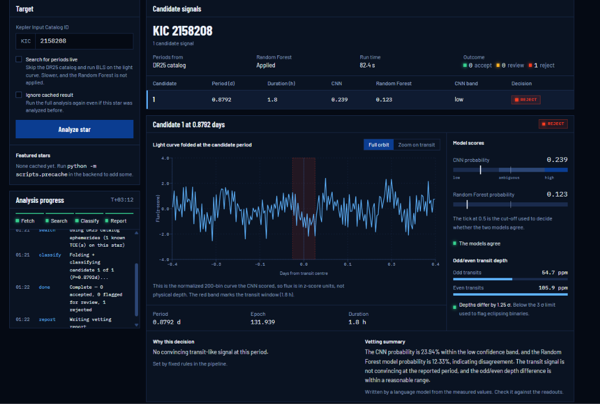
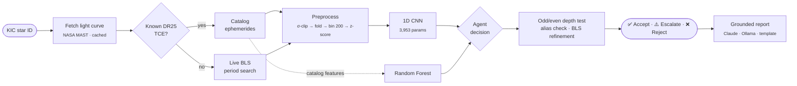
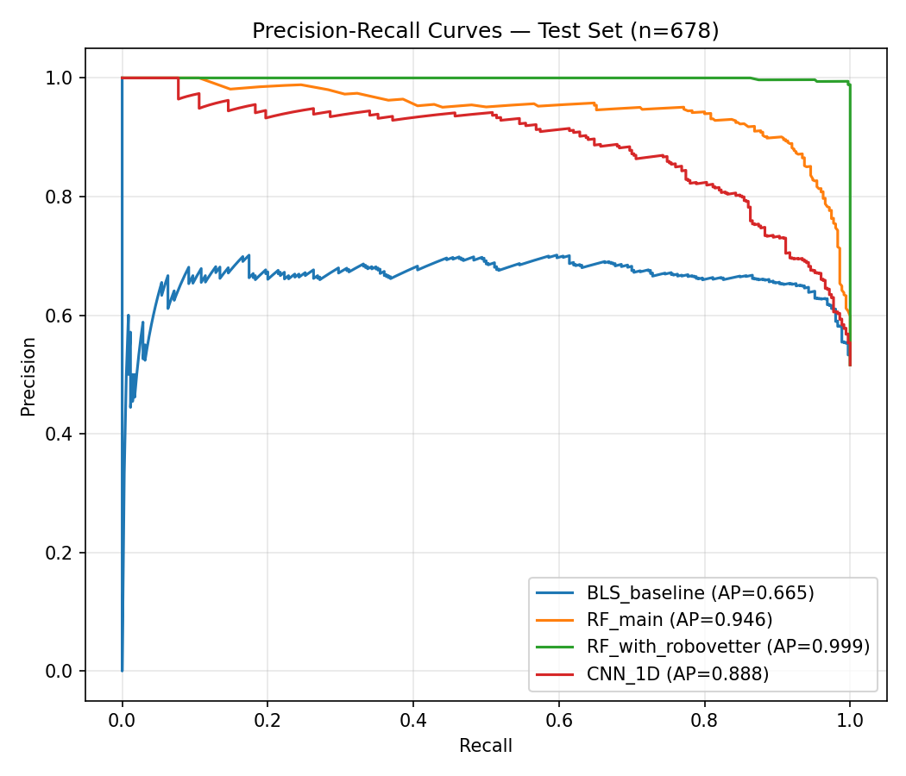
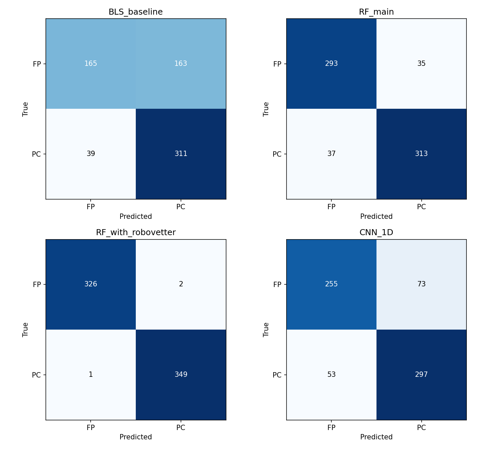
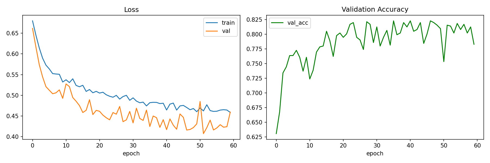
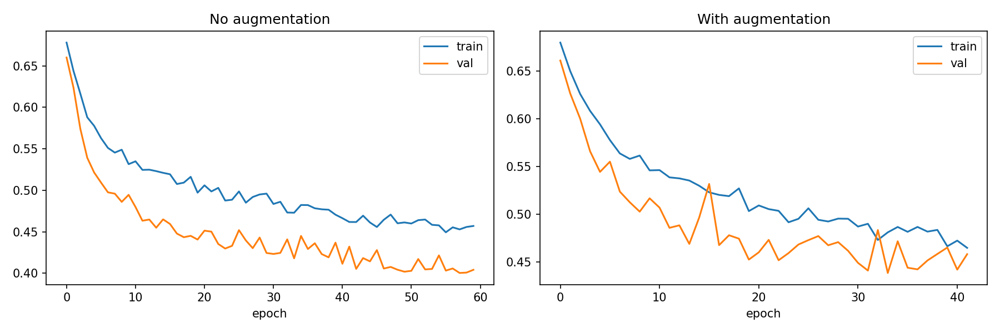
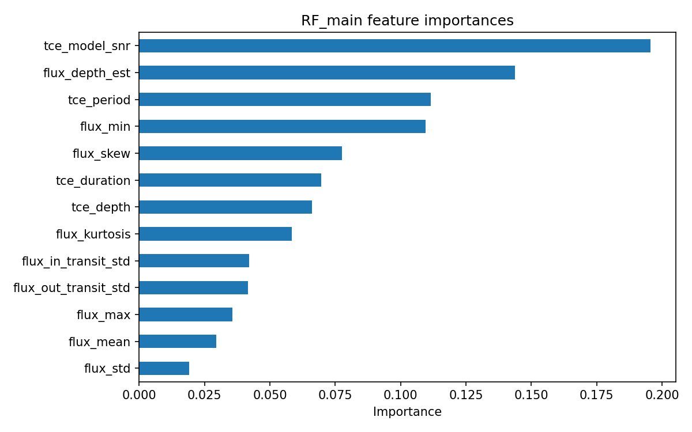

<div align="center">

# 🔭 SADA
### Stellar Anomaly Detection Agent

**Give it a Kepler star ID. It fetches the light curve from NASA, searches for transits,<br>classifies every candidate signal, and decides to accept, reject, or escalate it to a human.**

[](#)
[](#)
[](app/backend)
[](app/frontend)
[](https://exoplanetarchive.ipac.caltech.edu/)



</div>

---

## Contents

- [Why this exists](#why-this-exists)
- [How it works](#how-it-works)
- [Results](#results)
- [The agent: decisions you can audit](#the-agent-decisions-you-can-audit)
- [Quick start](#quick-start)
- [Repository layout](#repository-layout)
- [Research notebooks](#research-notebooks)
- [Design principles](#design-principles)
- [Limitations](#limitations)

---

## Why this exists

Over four years, Kepler measured the brightness of about 200,000 stars every 30 minutes. Each time its pipeline found a repeating dip, it logged a **Threshold Crossing Event (TCE)**: a possible planet. The DR25 catalog contains **34,032** of them.

Most of them are not planets. Of the 32,534 TCEs that NASA's Robovetter labelled, only **4,037** are planet candidates. The rest are eclipsing binaries, instrument noise or light from background stars, a ratio of roughly 7 false positives to every real candidate.

SADA is built in two layers:

| | Layer | What it is |
|---|---|---|
| 🧪 | **Research core** ([`research/`](research)) | A reproducible comparison of four classifiers (BLS baseline → 1D CNN → Random Forest → RF + Robovetter), with 5-fold cross-validation, an augmentation ablation and calibration analysis |
| 🤖 | **Agentic product** ([`app/`](app)) | A FastAPI agent and Next.js dashboard that put those models to work on any Kepler star, with every escalation rule tied to a measured weakness of the models |

---

## How it works



**Preprocessing** turns a 4-year light curve into one fixed-size picture of the transit:

1. Stitch every Kepler quarter into one time series
2. Remove outliers with a 3σ clip
3. Phase-fold on the orbital period, using the catalog epoch so the transit lands at **bin 100**
4. Bin to **200 points**, reject any curve with NaNs, then z-score normalize

The CNN's input is this 200-point array: the shape of the dip, averaged over every orbit.

---

## Results

The test set is the same stratified 70/15/15 split (seed 42) for every model, so the comparison is like for like. Cross-validation uses 5 stratified folds.

| Model | Input | Accuracy | F1 | ROC-AUC | 5-fold F1 |
|---|---|:---:|:---:|:---:|:---:|
| BLS baseline (LogReg) | 4 catalog stats | 70.2% | 0.755 | 0.731 | 0.746 ± 0.007 |
| **1D CNN** | 200-bin folded light curve | 81.4% | 0.812 | 0.888 | 0.818 ± 0.013 |
| **Random Forest** (`RF_main`) | catalog stats + 9 flux features | **89.4%** | **0.897** | **0.951** | **0.904 ± 0.012** |
| RF + Robovetter | + Robovetter score | 99.6% | 0.996 | 0.999 | 0.995 ± 0.001 |

> [!NOTE]
> **RF + Robovetter is an upper bound, not a competitor.** The Robovetter score is close to being the label itself, so this row measures how much expert prior knowledge is worth. It does not count as a model result.

**Findings worth knowing:**

- **The RF beats the CNN, and the gap is real.** The ~0.09 gap in F1 is 6–7× larger than either model's variance across folds.
- **Augmentation hurt.** Gaussian noise scaled to each sample's flux (0.3σ) lowered F1 from 0.812 to 0.787 and AUC from 0.888 to 0.870. At that strength the noise washes out the transit shape the CNN is trying to learn. This negative result is reported, not dropped.
- **The CNN is less well calibrated** (Brier 0.139 vs 0.083 for the RF) and misclassifies likely eclipsing binaries **23.6%** of the time vs **10.9%** for the RF. Both numbers became agent rules (see below).

<details>
<summary><b>📈 Diagnostic plots</b></summary>
<br>

| Precision–recall | Confusion matrices |
|---|---|
|  |  |

| CNN training curves | Augmentation ablation |
|---|---|
|  |  |

<p align="center"><br><sub>RF_main feature importances</sub></p>

</details>

---

## The agent: decisions you can audit

One star returns **one verdict per candidate period**, not one per star. 35% of the TCEs in this dataset share a host star with another TCE, so a single answer per star would often be wrong.

Each candidate is **accepted**, **rejected** or **escalated** to a human. Every escalation rule comes from a measured result, not a guess:

| Escalate when… | Because… |
|---|---|
| CNN confidence is in the **0.40–0.80** band | The reliability diagram shows the CNN is overconfident in exactly this range |
| Odd and even transit depths differ by **> 3σ** on a positive verdict | A classic eclipsing-binary signature, and the CNN's weakest category (23.6% error) |
| **CNN and RF disagree** | When two models trained on different evidence disagree, a human should decide |
| A positive candidate sits at a **low-order period ratio** of a stronger one | It could be a BLS alias *or* a real planet in resonance, and the periodogram can't tell them apart |

Two decisions in particular:

- **Aliases are flagged, never deleted.** Real systems such as Kepler-90 sit in 2:1, 3:2 and 4:3 resonances. Deleting small-integer period ratios would make SADA unable to ever find one.
- **The RF only runs on catalog targets.** It was trained on DR25 pipeline values (period, duration, depth, model SNR). A live BLS search produces different scales and has no SNR equivalent. Feeding those values to the RF would quietly shift its inputs away from what it was trained and measured on, so the API returns `rf_available: false` with a reason instead.

**LLM reports are kept to the measured values.** The language model only receives the structured measurements and is told not to add any fact that isn't in them: no planet radii, temperatures or talk of habitability. If no LLM is configured, a deterministic template writes the report instead. The template can't hallucinate, and it works offline.

---

## Quick start

**Requirements:** Python 3.10+, Node 20+

### 1 · Backend

```bash
cd app/backend
pip install -r requirements.txt

# point at the research models (single source of truth)
cat > .env <<'EOF'
SADA_MODELS_DIR=../../research/models
SADA_CATALOG_PATH=data/catalog_lookup.json
# ANTHROPIC_API_KEY=sk-...    # optional: LLM-written reports
EOF

uvicorn app.main:app --reload            # → http://localhost:8000/docs
```

> [!IMPORTANT]
> Model weights (`*.pt`, `*.joblib`) are git-ignored. You need `research/models/cnn_1d_best.pt`. Without it, `/analyze` returns **503**; it never makes up output. `rf_main.joblib` is optional. Run `python scripts/export_models_colab.py` for the export snippet, and check `GET /healthz` for the status of each model file.

### 2 · Frontend

```bash
cd app/frontend
npm install
npm run dev                               # → http://localhost:3000
```

Set `NEXT_PUBLIC_API_URL` if the API isn't on `localhost:8000`.

### 3 · Try it

Enter **`11442793`** (Kepler-90, an eight-planet system), **`10666592`** (HAT-P-7 b, a hot Jupiter) or **`6922244`** (Kepler-8 b). To make these demo stars load instantly, precompute them:

```bash
cd app/backend && python -m scripts.precache
```

### Tests

```bash
cd app/backend && python test_smoke.py
```

The tests use a synthetic light curve and a stubbed model, so they need no network access, no MAST and no trained weights. They cover preprocessing parity, BLS recovery of an injected transit, alias handling, both paths through the agent, report generation and the API endpoints.

<details>
<summary><b>API reference</b></summary>

| Method | Path | Purpose |
|---|---|---|
| `POST` | `/analyze` | Queue a star → `{job_id}`, or return a cached result instantly |
| `GET` | `/jobs/{job_id}` | Status, stage-by-stage progress and the result when done |
| `GET` | `/featured` | Precomputed demo stars |
| `GET` | `/healthz` | Status of each model file |

```json
POST /analyze
{ "star_id": 11442793, "force_live_search": false, "use_cache": true }
```

Why a job queue? A cold MAST fetch takes 20–90 s, and free hosting tiers cut off HTTP requests at about 30 s. The client polls `/jobs/{id}` and shows each stage as it completes.

</details>

<details>
<summary><b>Environment variables</b></summary>

| Variable | Default | Purpose |
|---|---|---|
| `SADA_MODELS_DIR` | `models` | Where model artifacts are loaded from |
| `SADA_CATALOG_PATH` | `data/catalog_lookup.json` | DR25 ephemeris lookup |
| `SADA_DB_PATH` | `cache/sada.db` | Job queue and result cache (SQLite) |
| `SADA_CORS_ORIGINS` | `*` | Comma-separated allowed origins |
| `SADA_LLM_PROVIDER` | auto | `anthropic` · `ollama` · `template` |
| `ANTHROPIC_API_KEY` | — | Enables Claude-written reports |
| `SADA_LLM_MODEL` | `claude-sonnet-4-6` | Claude model ID |
| `SADA_OLLAMA_HOST` / `SADA_OLLAMA_MODEL` | `localhost:11434` / — | Local LLM alternative |

</details>

More backend detail is in [`app/backend/README.md`](app/backend/README.md).

---

## Repository layout

```
SADA/
├── research/                  # Layer 1: reproducible ML research
│   ├── notebooks/             # 01 → 06, run in order
│   ├── data/                  # balanced_tce.csv + plots (.npy arrays git-ignored)
│   └── models/                # CV results, test predictions (weights git-ignored)
├── app/
│   ├── backend/               # Layer 2: FastAPI agent
│   │   ├── app/
│   │   │   ├── agent.py           # decision loop: accept / reject / escalate
│   │   │   ├── bls.py             # live BLS search + alias detection
│   │   │   ├── preprocessing.py   # identical to the training pipeline
│   │   │   ├── inference.py       # CNN + RF loading and prediction
│   │   │   ├── llm.py             # grounded report generation
│   │   │   ├── store.py           # SQLite job queue + cache
│   │   │   └── main.py            # API routes
│   │   ├── scripts/           # catalog builder, model export, precache
│   │   └── test_smoke.py
│   └── frontend/              # Next.js 16 · React 19 · Tailwind 4 · Recharts
├── docs/                      # screenshots
└── writeups/                  # weekly research logs
```

---

## Research notebooks

| # | Notebook | What it does |
|---|---|---|
| 01 | [`01_eda`](research/notebooks/01_eda.ipynb) | Merges the DR25 catalog (features) with Robovetter output (labels) on `kepid + tce_plnt_num`; builds the balanced 8,074-TCE set |
| 02 | [`02_eda`](research/notebooks/02_eda.ipynb) | The preprocessing pipeline, which can resume after interruption. **Source of truth for preprocessing.** |
| 03 | [`03_baseline_model`](research/notebooks/03_baseline_model.ipynb) | BLS baseline, RF_main and RF + Robovetter; 9 hand-built flux features |
| 04a | [`04a_cnn_model`](research/notebooks/04a_cnn_model.ipynb) | 1D CNN: 3 conv blocks (8→16→32), global average pooling, AdamW, early stopping |
| 04b | [`04b_cross_validation`](research/notebooks/04b_cross_validation.ipynb) | 5-fold stratified CV across all four models |
| 04c | [`04c_augmentation_ablation`](research/notebooks/04c_augmentation_ablation.ipynb) | Noise-augmentation ablation (a negative result) |
| 05 | [`05_predictions_and_diagnostics`](research/notebooks/05_predictions_and_diagnostics.ipynb) | Calibration, reliability diagrams, error analysis |
| 06 | [`06_extended_analysis`](research/notebooks/06_extended_analysis.ipynb) | Further CNN analysis |

The weekly writeups in [`writeups/`](writeups) record the reasoning behind each decision, including the bugs found along the way.

---

## Design principles

- **Fail loudly, never fabricate.** No model means a 503, not a guess. The export script checks that the CNN has exactly 3,953 parameters and that the RF's feature order matches. Each `requirements.txt` pin explains why it is pinned.
- **Training and serving use the same preprocessing.** [`preprocessing.py`](app/backend/app/preprocessing.py) reproduces notebook 02 step for step. Changing one without the other would silently invalidate the served model.
- **There is one copy of the weights.** The backend loads models straight from `research/models/`, so retraining can't leave it serving an outdated copy.
- **Report what didn't work.** The failed augmentation, the CNN losing to the RF and the CNN's calibration gap all appear in the results.
- **Size the model to the data.** With ~3,160 training examples, the CNN was cut from 15k to 3,953 parameters on purpose.

---

## Limitations

- **The labels are Robovetter dispositions**, not confirmed planets. SADA learns to match an expert system, which is not the same as ground truth.
- **Training data covers 4,515 of the 8,074 balanced TCEs.** The rest dropped out during preprocessing, either failing to fetch or failing validation, so the training set is smaller than the catalog subset.
- **Kepler only.** TESS light curves have different cadence and noise and would need retraining.
- **On live-search targets the CNN works alone**, without the RF as a second opinion, for the reasons given above.

---

<div align="center">
<sub>Data: <a href="https://exoplanetarchive.ipac.caltech.edu/">NASA Exoplanet Archive</a> · <a href="https://archive.stsci.edu/">MAST</a> · <a href="https://github.com/nasa/kepler-robovetter">Kepler Robovetter</a> · Light curves via <a href="https://docs.lightkurve.org/">lightkurve</a></sub>
</div>
